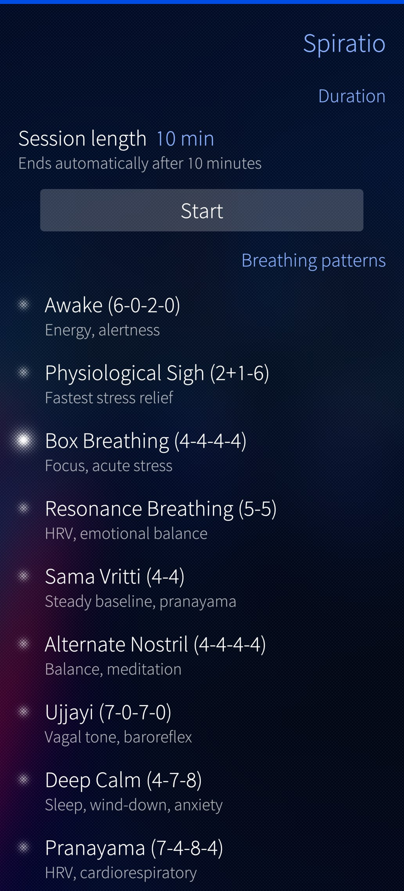
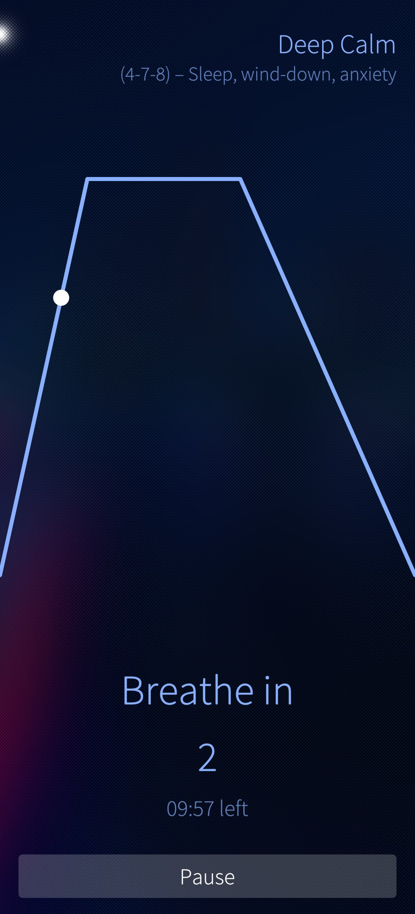
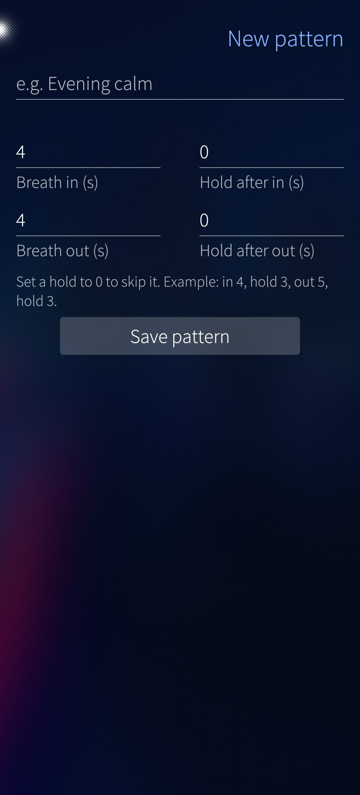

# Spiratio 

## About

Spiratio is a personal breathing companion for Sailfish OS, offering a range of proven breathing techniques to help manage stress, find calm, meditate and achieve deep relaxation.

Explore a variety of predefined breathing patterns or create your own. Follow your breathing in real time with a live breathing graph, with optional audio cues to guide each session. 

## Features

- Predefined breathing patterns (box breathing, 4-7-8, diaphragmatic, and more)
- Custom patterns with a built-in pattern editor
- Real-time breath graph animation
- Audio cues on phase transitions (mixes with other audio, does not interrupt media playback)
- Flexible session durations: 3 to 30 minutes, or endless

## Download

Download the latest release from:

[no release yet]

## Screenshots

  

## Translations

New languages can be added via GitHub. Incomplete translations may not be accepted or included in the app.

## Audio

Audio cues are played using `QSoundEffect` (16-bit PCM WAV). This uses the "event" audio resource class, so it mixes on top of other audio (music, podcasts) without pausing it.

## Requirements

* Sailfish OS SDK with a build target for Sailfish OS 4.6.0.13 or newer.

## Build

Clone or download this repository and import it into your Sailfish OS IDE using the `harbour-spiratio.pro` project file.

## Repository branches

* `main`: Release branch containing the current version of Spiratio.

## Contributions

Contributions to this project are welcome. All contributions must respect the project's existing Sailfish OS build target and Silica design guidelines.

When submitting a pull request, please include a clear explanation of the changes.

## License

Licensed under the [GNU General Public License v3.0](https://www.gnu.org/licenses/gpl-3.0.html).   
